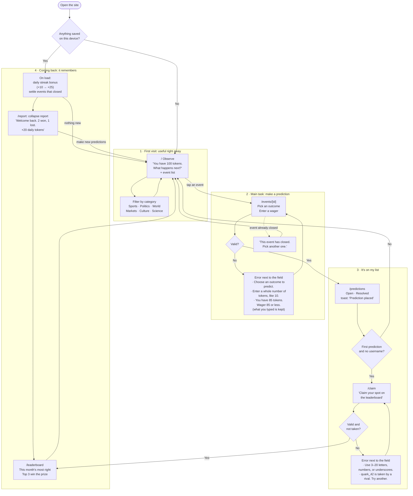

# The Observer Effect

*Nothing is decided until you observe it.*

A prediction game: pick what you think will happen in sports, politics, world news, markets, culture, and science, and wager tokens on it. If you're right, you win 2× your wager. If you're wrong, you lose it. You start with 100 tokens and get a daily bonus that grows from +10 to +25 the more days in a row you come back. Each month, the three people who were **most right** win a cash prize. Nobody ever risks their own money; the site is ad-supported.

Built for MPCS 51238 *Design, Build, Ship*, Assignment 3: Patterns & Flows.

- **Live:** _coming soon (Vercel)_
- **Stack:** Next.js + Tailwind CSS. Data is saved in your browser (`localStorage`), with no accounts or database.

## Main flow

> I pick an outcome and wager tokens → it's in my open predictions → I come back tomorrow, my +10 tokens are waiting, and the events that closed have *collapsed* into wins or losses.



The diagram is also in [`flows.md`](flows.md), along with a table of screens and routes.

## Onboarding research

We studied how **Manifold Markets**, **Metaculus**, and **ESPN Pick'em/Streak** welcome someone new. All three require an account before your first prediction. We don't: you predict first and claim a name afterward. What we borrowed:

- **The balance is the headline** (Manifold): "You have 100 tokens. What happens next?"
- **A crowd anchor** (Metaculus): every event shows what the crowd thinks, so your first guess isn't made blind.
- **Fast first feedback** (a lesson from Metaculus's slow resolutions): some events close within a day.
- **A growing daily streak** (Manifold): +10, +15, +20, up to +25 tokens for coming back on consecutive days.
- **A "while you were away" report** (Metaculus's resolution email): what resolved, what you won, what you lost.
- **An honest prize facts strip** (ESPN): free to play, top 3 win cash monthly, you never risk money.

Full notes and sources: [`research.md`](research.md).

## First-run check

_Coming after deployment: an agent tries the live site as a brand-new user and gives usability feedback._

## Run locally

```bash
npm install
npm run dev
```

Open http://localhost:3000. To test the "coming back" flow without waiting a day, use **Simulate tomorrow** in the footer.
