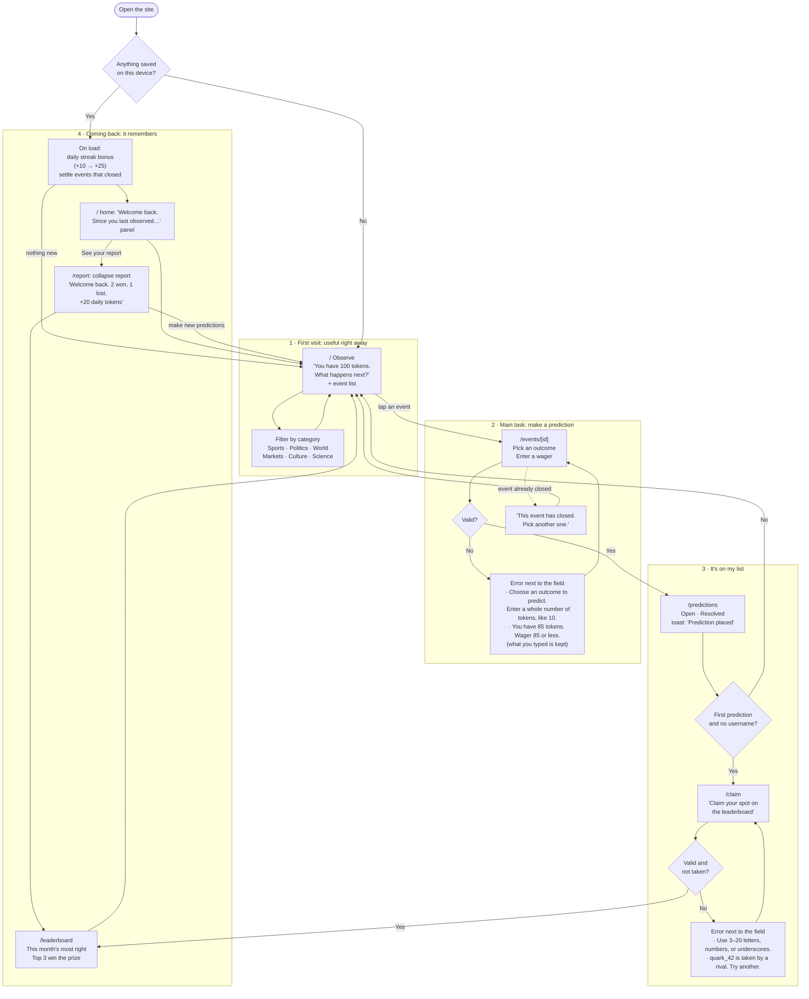

# The Observer Effect: User Flows

**Main task, as one sentence:**

> I pick an outcome and wager tokens → it's in my open predictions → I come back tomorrow, my +10 tokens are waiting, and the events that closed have *collapsed* into wins or losses.

## Flow diagram

## Screens (one route per step, with shared navigation)

| Step | Route | Purpose |
|---|---|---|
| First visit | `/` | Tokens up front, events to pick from immediately. No empty screen. |
| Main task | `/events/[id]` | One-column form: outcome + wager, with inline errors. |
| On my list | `/predictions` | Open and resolved predictions. |
| Claim name | `/claim` | Username (after the first prediction, not before). |
| Coming back | `/report` | What happened since you last observed. |
| Reason to return | `/leaderboard` | Monthly ranking. The top 3 win cash. |

**Navigation:** a top bar on every page with Observe · My predictions · Leaderboard, the token balance, and your name (or "Claim name"). The current page is highlighted (`aria-current`). Event pages link back to the filtered list you came from.
